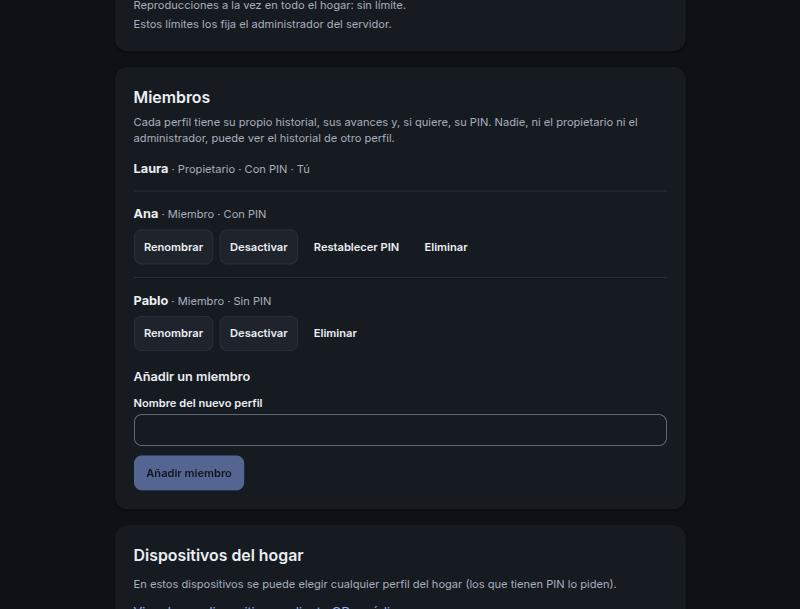
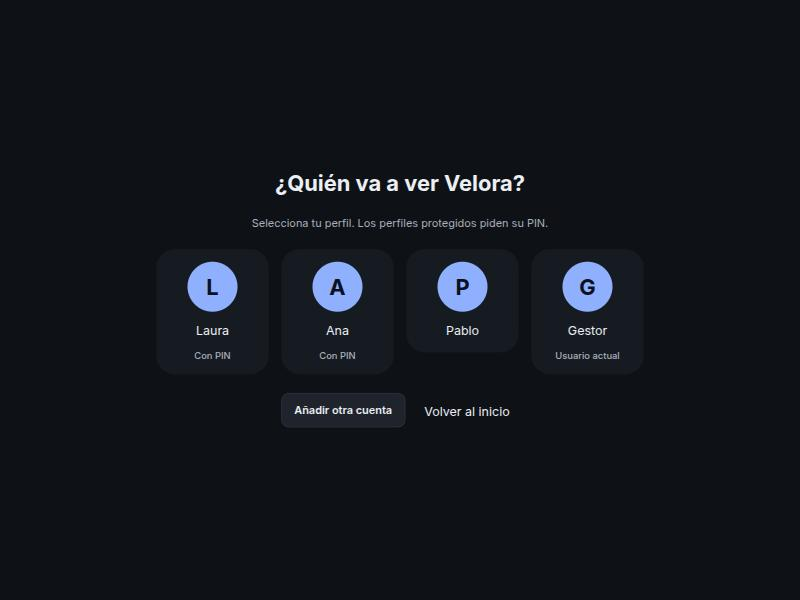

# 3. Cuentas y hogares

## Quién puede hacer qué

| Papel | Puede | No puede |
| --- | --- | --- |
| **Administrador** | Crear cuentas principales (con o sin contraseña). Dar o retirar el permiso «Puede crear su propio hogar». Fijar el máximo de perfiles y de reproducciones simultáneas de cada hogar. Ver la estructura de cuentas y hogares. Desactivar cuentas. Ver las reproducciones activas para diagnosticar problemas. | Entrar en un perfil ajeno. Ver historial, avances, «Continuar viendo» o listas de nadie. Quitar el PIN de un miembro de un hogar. Recuperar un historial guardado aparte. |
| **Propietario de un hogar** | Crear su hogar si tiene permiso. Añadir, renombrar, desactivar y eliminar miembros dentro de su límite, y recuperarlos de la papelera. Restablecer el PIN de un miembro (su historial se guarda aparte). Vincular y retirar dispositivos. Ver sus límites. | Ver el historial de un miembro. Cambiar sus propios límites. Entrar en un perfil con PIN sin conocerlo. Administrar el servidor. |
| **Miembro** | Usar su perfil, con historial y avances propios. Activar un PIN y elegir cuándo se vuelve a pedir. Recuperar su PIN con su código. | Crear hogares, gestionar miembros, vincular dispositivos, administrar. |

## Tipos de cuenta

- **Cuenta con contraseña**: el administrador la crea en **Panel de control → Usuarios → Cuenta tradicional con
  contraseña**. Se entra con usuario y contraseña.
- **Cuenta sin contraseña**: la persona abre Velora en su dispositivo, que muestra un **QR y un código de seis dígitos**.
  Se lo comunica al administrador por un canal de confianza. El administrador, en **Usuarios → Dar de alta una cuenta
  sin contraseña**, escribe el código, pulsa **Comprobar dispositivo** (ve el nombre y la IP del aparato), rellena
  usuario y nombre visible, marca las bibliotecas y, si quiere, **Puede crear su propio hogar**. Al confirmar, ese
  dispositivo queda dentro de la cuenta, sin contraseña.

El código de seis dígitos caduca en cinco minutos y solo vale una vez. El QR no sirve para recoger la sesión: el
dispositivo guarda además otra credencial privada. No compartas capturas del QR.

## Crear un hogar

Solo si el administrador te ha dado el permiso:

1. Abre **Perfil → Mi cuenta**.
2. En **Crear mi hogar** pulsa el botón y confirma con **Sí, crear mi hogar**.

Tu cuenta pasa a ser la del **propietario** y el hogar se llama «Familia de …» (puedes cambiarlo en **Mi hogar → Cambiar
nombre**). Tus bibliotecas y permisos de reproducción no cambian: los miembros heredan los tuyos.

## Mi hogar

En **Perfil → Mi hogar** el propietario ve:

- **Tu hogar**: el nombre, cuántos perfiles tiene y cuántos admite («Perfiles: 3 de 10, contándote a ti») y cuántas
  reproducciones a la vez permite. Estos límites los fija el administrador.
- **Miembros**: cada perfil con su estado y si tiene PIN.
  - **Añadir un miembro**: basta con el nombre. Aparece al momento en **Cambiar usuario** de los dispositivos del hogar.
  - **Renombrar**.
  - **Desactivar / Reactivar**: un perfil desactivado no puede entrar hasta que lo reactives.
  - **Restablecer PIN**: solo si el miembro ha olvidado su PIN **y** no tiene su código de recuperación. Ver
    [capítulo 4](04-pin-bloqueo-privacidad.md#si-alguien-restablece-tu-pin).
  - **Eliminar**: el perfil va a la papelera (abajo).
- **Eliminados recientemente** (la papelera).
- **Dispositivos del hogar**: los aparatos autorizados, con **Retirar**, y el enlace para vincular uno nuevo.

Un miembro que abre **Mi hogar** solo ve el nombre del hogar y quién lo forma.

### La papelera de 30 días

Al **Eliminar** un miembro:

- Su perfil desaparece al instante de la lista y de **Cambiar usuario**, se cierran sus sesiones y deja de poder
  reproducir (y de contar en las reproducciones simultáneas).
- Su historial y sus avances se conservan intactos, sin que nadie pueda verlos.
- Durante **30 días** puedes **Recuperar** el perfil tal como estaba. Hace falta un hueco libre dentro de tu límite de
  perfiles y que el administrador no te haya retirado el permiso de hogar.
- **Eliminar ya** lo borra en ese momento, con todo su historial. Pide dos confirmaciones y no se puede deshacer.
- Pasados los 30 días, Velora lo elimina definitivamente por la noche.

### Límites del hogar

- **Perfiles**: 10 por defecto, contando al propietario (el administrador puede fijar entre 1 y 20). Al llegar al
  máximo, **Añadir un miembro** explica por qué no se puede.
- **Reproducciones simultáneas**: cuentan las de todos los perfiles del hogar juntos. Puede ser el valor general del
  servidor o uno propio del hogar; «sin límite» si el administrador lo deja en 0.
- Si el administrador **baja** un límite, no se elimina a nadie: solo se impide añadir más.
- Si **retira el permiso de hogar**, el hogar sigue funcionando con sus miembros, pero no se pueden añadir ni recuperar
  miembros hasta que lo vuelva a dar.

## Dispositivos y Cambiar usuario

Un **dispositivo autorizado** para el hogar puede abrir cualquier perfil del hogar desde **Perfil → Cambiar usuario**
(«¿Quién va a ver Velora?»). Los perfiles sin PIN se abren directamente; los que tienen PIN lo piden.

Para autorizar otro dispositivo (solo el propietario, o el administrador):

1. En el aparato nuevo, abre Velora: muestra un QR y un código de seis dígitos.
2. En un dispositivo donde ya estás dentro, ve a **Perfil → Vincular dispositivo**, escribe el código (o escanea el QR
   con la app) y pulsa **Comprobar dispositivo**.
3. Comprueba que el nombre coincide, elige el **perfil** que se abrirá en el aparato y, si tiene PIN, escríbelo.
4. Pulsa **Autorizar este dispositivo**.

Los miembros no pueden autorizar dispositivos, ni siquiera los suyos: lo hace el propietario. **Retirar** un dispositivo
cierra todas las sesiones del hogar en él. **Cerrar sesión** en un dispositivo también le quita la autorización del hogar.

En un navegador puedes tener además varias cuentas principales recordadas: **Cambiar usuario → Añadir otra cuenta**.

## Contraseña y códigos de acceso (cuentas con contraseña)

En **Perfil → Contraseña y códigos de acceso** puedes generar **códigos de recuperación de la contraseña** (confirmando
tu contraseña). Cada uno sirve una vez y caduca al año; generar una lista nueva invalida la anterior. Si olvidas la
contraseña, usa uno en la pantalla **Recuperar acceso**. Si no tienes códigos, el administrador puede restablecer tu
contraseña (ver [capítulo 4](04-pin-bloqueo-privacidad.md#restablecimientos-hechos-por-otra-persona)).

No confundas estos códigos con el **código de recuperación del PIN**, que es otro y se ve en **Mi cuenta / Mi perfil**.
