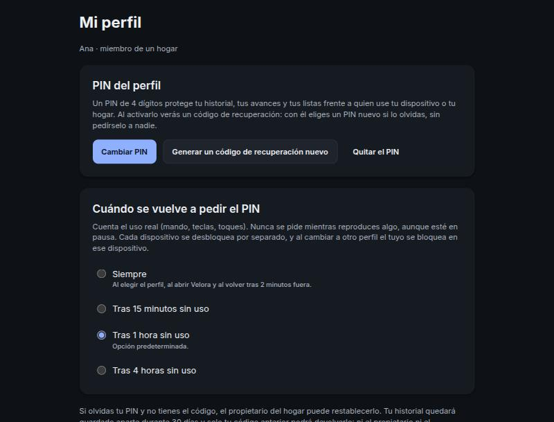
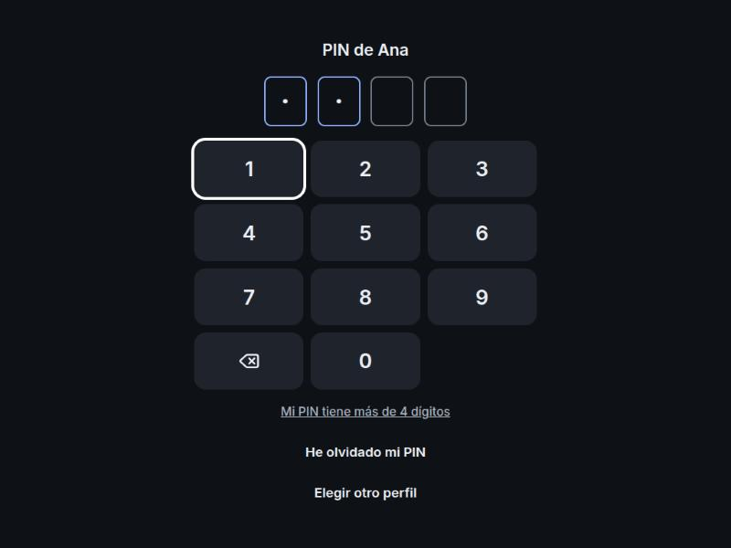
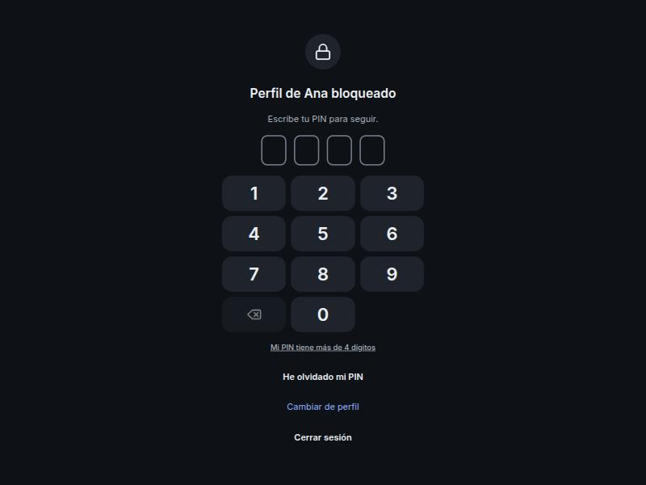

# 4. PIN, bloqueo y privacidad

## Qué protege el PIN

El PIN es **opcional** y de **4 dígitos**. Protege tu perfil frente a quien use tu dispositivo o tu hogar: tu historial,
tus avances, «Continuar viendo», el siguiente episodio, tus listas y tus preferencias. Se pide:

- al elegir tu perfil en **Cambiar usuario**;
- al vincular un dispositivo a tu perfil (lo haga el propietario o el administrador);
- cuando tu perfil se ha bloqueado por falta de uso (más abajo).

Si el propietario de un hogar tiene PIN, ese PIN protege también la gestión del hogar.

El PIN no es la contraseña de tu cuenta ni sustituye el bloqueo de pantalla del móvil o del ordenador. Se guarda cifrado
(solo su huella) y el servidor limita los intentos.

## Activar, cambiar o quitar el PIN

En **Perfil → Mi cuenta** (o **Mi perfil** si eres miembro de un hogar):

- **Activar PIN**: escribe 4 dígitos y repítelos. A continuación verás tu **código de recuperación** (por ejemplo
  `K7Q2-9MPX`). **Solo se muestra esa vez.** Apúntalo y guárdalo fuera de Velora; en el navegador puedes pulsar
  **Guardar en un archivo**.
- **Cambiar PIN**: escribe tu PIN actual y después el nuevo dos veces. Recibes un código de recuperación nuevo; el
  anterior deja de valer.
- **Generar un código de recuperación nuevo**: con tu PIN actual. El anterior deja de valer.
- **Quitar el PIN**: con tu PIN actual.

Si tu cuenta tiene contraseña, al cambiar o quitar el PIN puedes confirmar con la contraseña en lugar del PIN
(**He olvidado mi PIN: usar mi contraseña**). Una sesión abierta nunca basta para cambiar el PIN: siempre se comprueba
el PIN, la contraseña o el código en ese momento.

Los PIN antiguos de 5 a 8 dígitos siguen valiendo hasta que los cambies: en el teclado pulsa **Mi PIN tiene más de 4
dígitos**.

## El teclado de PIN

Cuatro casillas y un teclado numérico en pantalla. Al escribir el cuarto dígito se comprueba solo. Puedes usar:

- el ratón o el dedo;
- las teclas numéricas del teclado o del **mando de la TV**;
- las flechas del mando para moverte por el teclado y OK para pulsar.

## He olvidado mi PIN

Con tu código de recuperación no necesitas a nadie y **no pierdes nada**:

1. En **Cambiar usuario**, elige tu perfil (o, si está bloqueado, quédate en la pantalla de bloqueo).
2. Pulsa **He olvidado mi PIN**.
3. Escribe tu código de recuperación (da igual mayúsculas o minúsculas, y el guion es opcional).
4. Elige un PIN nuevo y repítelo.
5. Velora abre tu perfil y te muestra un **código de recuperación nuevo** (el anterior ya no vale). Guárdalo.

Solo funciona en dispositivos donde tu perfil se puede elegir (un dispositivo de tu hogar o un navegador donde tu cuenta
está recordada).

## Si alguien restablece tu PIN

Si olvidas el PIN **y** no tienes el código, el propietario del hogar puede **Restablecer PIN** en **Mi hogar**
(confirmando con su propio PIN si lo tiene). Para que nadie pueda usar esto para ver tu historial:

- Tu historial y tus avances **se guardan aparte**, en un lugar que ninguna pantalla de Velora lee. Ni el propietario
  ni el administrador pueden verlo ni devolverlo.
- Tu perfil queda **sin PIN y vacío**. Al abrirlo, Velora te lleva a **Mi perfil** para que elijas un PIN nuevo.
- Solo tu **código de recuperación anterior** (el que tenías antes del restablecimiento) devuelve el historial: en
  **Mi perfil → Tu historial anterior está guardado aparte → Recuperar mi historial**. Si desde entonces has visto algo,
  para cada título se conserva el avance más reciente.
- Si no lo recuperas en **30 días**, se elimina.

### Restablecimientos hechos por otra persona

La regla es general: **cualquier restablecimiento hecho por alguien que no es el titular de un perfil con PIN guarda
aparte su historial**. Afecta a:

1. El propietario que restablece el PIN de un miembro.
2. El administrador que restablece la **contraseña** de una cuenta con PIN (la contraseña nueva la conoce él; con ella no
   debe poder ver tu historial). Además se quita el PIN.
3. El administrador que restablece el PIN de una cuenta principal **sin contraseña** que lo ha olvidado y no tiene
   código (es la única salida en ese caso).

El administrador **no puede** quitar el PIN de un miembro de un hogar: eso le corresponde al propietario, siempre con
la regla anterior.

## Bloqueo por inactividad

Si tu perfil tiene PIN, eliges en **Mi cuenta / Mi perfil → Cuándo se vuelve a pedir el PIN**:

| Opción | Cuándo se pide |
| --- | --- |
| **Siempre** | Al elegir el perfil, al abrir Velora y al volver tras más de 2 minutos fuera. |
| **Tras 15 minutos sin uso** | Tras 15 minutos sin tocar nada. |
| **Tras 1 hora sin uso** (predeterminada) | Tras una hora sin tocar nada. |
| **Tras 4 horas sin uso** | Tras cuatro horas sin tocar nada. |

- Cuenta como uso lo que haces de verdad: el mando, las teclas, los toques y los clics. Las comprobaciones automáticas
  de la app no cuentan.
- **Nunca se pide mientras el reproductor está abierto**, reproduciendo o en pausa. Si la TV suspende la app (por ejemplo
  con el salvapantallas en una pausa muy larga), el tiempo empieza a contar desde ese momento.
- Cada dispositivo se desbloquea por separado.
- Al cambiar a otro perfil, el tuyo queda bloqueado en ese dispositivo.
- El bloqueo lo aplica **el servidor**: con el perfil bloqueado no se carga nada privado hasta escribir el PIN, aunque
  alguien intente saltarse la pantalla.

En la pantalla de bloqueo puedes escribir el PIN, usar **He olvidado mi PIN**, **Cambiar de perfil** o **Cerrar sesión**.

## Intentos fallidos

Tras varios intentos fallidos (de PIN o de código de recuperación, que cuentan juntos), Velora obliga a esperar unos
minutos, cada vez más. Al entrar en tu perfil verás un aviso con los intentos fallidos desde tu última visita: si no has
sido tú, cambia tu PIN. El administrador solo ve **cuántos** intentos fallidos ha habido en 30 días y **cuándo** fue el
último; nunca desde qué dispositivo ni nada de tu contenido.

## Qué puede ver cada uno

| | Tú | Propietario | Administrador |
| --- | --- | --- | --- |
| Tu historial, avances, «Continuar viendo», listas, preferencias | Sí | No | No |
| Tu historial guardado aparte tras un restablecimiento | Con tu código anterior | No | No |
| Que tu perfil existe, su nombre, si tiene PIN, si está desactivado o en la papelera | Sí | Sí | Sí |
| Número y fecha de intentos fallidos de PIN (30 días) | Sí, al entrar | No | Sí |
| Lo que se está reproduciendo **ahora** (título, perfil, dispositivo, calidad, IP) | — | No | Sí, mientras dura |

La última fila es **supervisión técnica**: sirve para diagnosticar cortes o conversiones. Desaparece al terminar la
reproducción y no da acceso a tu historial.

### El límite técnico de esta protección

La privacidad de los perfiles te protege frente a **otros usuarios a través de Velora**. Quien controla el servidor
(el equipo, la base de datos o sus copias de seguridad) puede leer directamente la base de datos, incluido lo guardado
aparte. Si eso te preocupa, usa Velora en un servidor de alguien de tu confianza.
