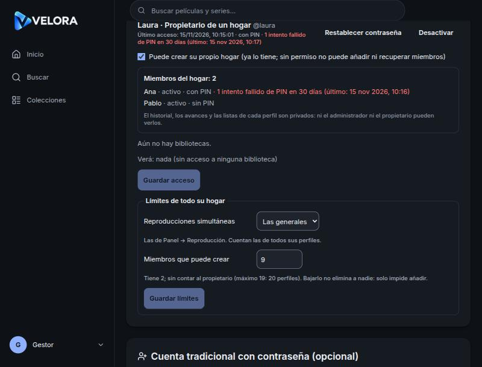

# 5. Administración del servidor

El **Panel de control** se abre desde **Perfil → Panel de control** (no aparece en la app de TV).

## Resumen

- **Estado del servidor**: archivos, películas, usuarios activos y reproducciones optimizadas ahora.
- **Reproduciendo ahora**: cada reproducción activa con título, perfil, dispositivo, calidad, si se está convirtiendo y
  la IP. Es supervisión técnica para diagnosticar problemas; desaparece al terminar y no muestra historiales.
- **Reproducción** (ajustes):
  - **Reproducciones simultáneas**: el límite general por cuenta (y por hogar, contando todos sus perfiles) y, si lo
    activas, un límite por dirección IP, que comparten todas las cuentas que usan esa IP.
  - **Adaptación de vídeo y audio**: qué hacer con un vídeo incompatible (automático, preferir hardware con respaldo por
    software; solo software; o no convertir vídeo), y la resolución y el bitrate máximos al convertir. Los archivos
    compatibles se envían con su calidad original.
- **Últimos escaneos** y **carpetas sin película** (las que no se han podido reconocer).

## Usuarios



En **Panel de control → Usuarios**:

- **Dar de alta una cuenta sin contraseña** (con el código de seis dígitos de su dispositivo) o una **cuenta
  tradicional con contraseña**. Ver [capítulo 3](03-cuentas-y-hogares.md#tipos-de-cuenta).
- Por cada cuenta principal:
  - **Bibliotecas** que puede ver, con una vista previa de lo que verá. Una cuenta nueva no ve nada. Los miembros de un
    hogar heredan las del propietario.
  - **Puede crear su propio hogar**: el permiso de hogar. Retirarlo no elimina miembros; solo impide añadir o recuperar.
  - **Límites de todo su hogar**: reproducciones simultáneas («Las generales» o propias; 0 = sin límite) y **miembros
    que puede crear** (0 a 19 sin contar al propietario; 9 por defecto, es decir, 10 perfiles). Bajarlo no elimina a nadie.
  - **Miembros del hogar** (solo estructura): nombre, si está activo, desactivado o en la papelera (con su fecha), si
    tiene PIN y el número y fecha de intentos fallidos. Nunca su historial.
  - **Restablecer contraseña** (cuentas con contraseña; pide tu contraseña de administrador). Si la cuenta tiene PIN, su
    historial se guarda aparte y se quita el PIN ([capítulo 4](04-pin-bloqueo-privacidad.md#restablecimientos-hechos-por-otra-persona)).
  - **Restablecer PIN** (solo cuentas principales sin contraseña; nunca miembros de un hogar), con la misma regla.
  - **Desactivar / Reactivar**: desactivar cierra sus sesiones. Desactivar a un propietario deja sin acceso a todo su hogar.

Los cambios de bibliotecas se aplican en la siguiente acción del usuario y cortan en menos de 30 segundos lo que esté
reproduciendo de una biblioteca retirada.

Para volver a vincular una cuenta que ya existe (por ejemplo, tras cambiar de televisor), usa **Perfil → Vincular
dispositivo** y elige esa cuenta: no hace falta crear otra.

## Bibliotecas e intros y créditos

En **Bibliotecas** añades, quitas y vuelves a escanear carpetas. En **Intros y créditos** ves el avance de la detección
por comparación de audio y puedes detenerla. La detección trabaja por temporadas y guarda lo aprendido, así que los
episodios nuevos se procesan más deprisa.

## Metadatos

En **Metadatos** configuras TMDB, las fuentes de imágenes (Fanart.tv, TheTVDB, OMDb) y OpenSubtitles ([cómo obtener las claves](../providers.md)). Desde el menú de cualquier título puedes:

- **Identificar…**: elegir el resultado correcto si Velora se ha equivocado (en una serie, también se corrigen temporadas
  y episodios).
- **Editar información…** y **Editar imágenes…** (puedes subir una imagen propia). Los campos editados a mano quedan
  bloqueados frente a actualizaciones automáticas, salvo que marques **Sustituir también los campos bloqueados**.
- **Completar lo que falta (TMDB)** y **Ver archivos…**.

## Copias de seguridad

Velora hace una copia de la base de datos cada noche (a las 04:00) y en **Copias de seguridad** puedes crear otra cuando
quieras. La lista muestra la fecha, el tamaño y la verificación de cada copia, y avisa si el espacio libre va a bajar del
margen de seguridad. Las copias de la aplicación no incluyen todos los secretos de la instalación: guarda también `deploy/.env` y el
volumen `config` (con su carpeta `secrets`) en un lugar privado. Detalles en
[Instalar y mantener Velora](../installation.md#actualizar).

## Recuperar el acceso del administrador

Si el administrador pierde su contraseña y no tiene códigos, desde el equipo del servidor:

```sh
docker compose --env-file deploy/.env -f deploy/compose.yaml exec server velora recovery-code NOMBRE_ADMIN
```

El código es temporal y de un solo uso; introdúcelo en **Recuperar acceso**.

## Medida de emergencia: desactivar el bloqueo por inactividad

Si el bloqueo de perfiles diera problemas, se puede desactivar para todo el servidor **sin tocar ningún PIN** (los PIN
se siguen pidiendo al cambiar de perfil):

```sh
docker compose --env-file deploy/.env -f deploy/compose.yaml exec db psql -U velora -d velora -c \
  "insert into settings (key, value) values ('profiles.lock_enabled', 'false') on conflict (key) do update set value = excluded.value"
```

Para volver a activarlo, borra el ajuste:

```sh
docker compose --env-file deploy/.env -f deploy/compose.yaml exec db psql -U velora -d velora -c \
  "delete from settings where key = 'profiles.lock_enabled'"
```

## Tareas nocturnas

Cada noche el servidor hace la copia de seguridad y elimina los miembros que llevan más de 30 días en la papelera y los
historiales guardados aparte con más de 30 días.
